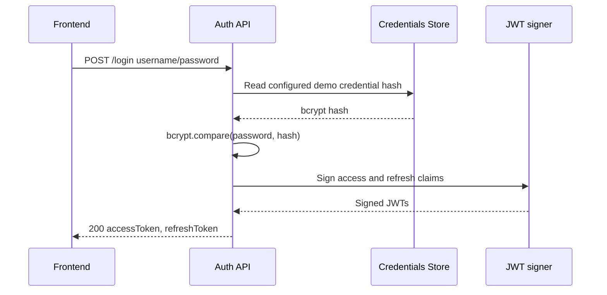
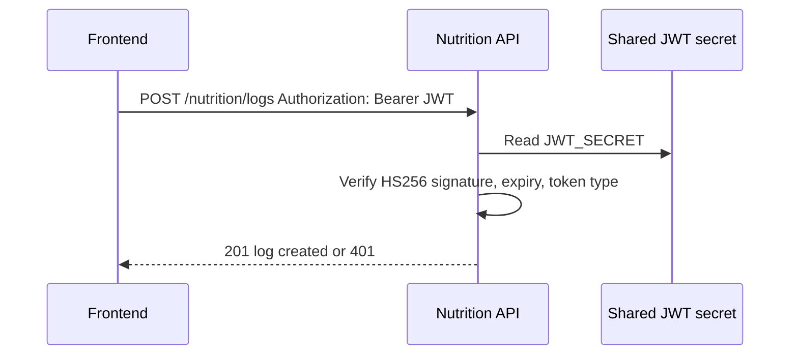
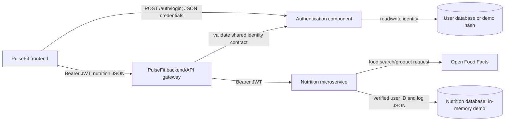

# PulseFit Authentication Report

## 1. Mechanism

PulseFit uses an own-service JWT authentication mechanism. `POST /api/v1/auth/login` verifies a username and bcrypt password hash, then issues a short-lived HS256 access token and a longer-lived refresh token. The bearer approach is stateless and separates authentication from the nutrition microservice, which only verifies signatures and expiry with the shared secret.

This was preferred over server sessions because the architecture can be scaled across frontend/backend clients without sticky sessions. OAuth 2.0/OIDC is stronger for delegated third-party identity, but would add an external identity provider and browser redirect setup not needed for this microservice simulation. A passwords-in-main-API design is also less reusable by other PulseFit services than a shared authentication component.

Pros: no server session lookup, simple cross-service Bearer contract, short-lived credential, refresh separation. Cons: symmetric-secret distribution, refresh-token revocation, and token theft risk.

## 2. Flow diagrams

### Login

### Protected request

## 3. Token and credential lifecycle

Access and refresh JWTs contain `sub`, `type`, `iat`, and `exp`; only a non-sensitive demo identifier is placed in the payload. Access tokens expire after 15 minutes and refresh tokens after 7 days. A refresh token calls `/api/v1/auth/refresh`; otherwise the user logs in again. Logout should revoke refresh-token identifiers in a production revocation store. Access tokens cannot be individually revoked unless short expiry and a denylist are added.

Passwords are stored as bcrypt hashes; plaintext is used only at the transient login request boundary and is never JWT data. Public third-party credentials are not used.

## 4. Architecture and contracts

Frontend obtains tokens from login, should keep the access token in memory and refresh token in a Secure HttpOnly SameSite cookie, and sends the access token as `Authorization: Bearer <token>`. Backend and microservices trust the same identity contract: HS256 signature, shared secret, issuer-independent simulation, `sub` identity, `type=access`, expiry, and pinned algorithm. A production deployment should use a centralized key service or asymmetric keys instead of distributing a symmetric secret broadly.

## 5. Failure behavior

- Authentication unavailable: 500 to operators and generic unavailable message to clients; clients keep existing cached data and re-login after recovery.
- Database unavailable: login is denied safely and a generic 500 or 503 is returned; credentials are not leaked.
- Nutrition database unavailable: the request returns 500 without stack traces and can be retried.
- Open Food Facts unavailable or timed out: search returns an empty `fallback=true` response and macro lookup returns not found/unavailable information.

## 6. Security and OWASP Top 10:2025 risks

Applied: environment secrets, `.gitignore`, bcrypt password comparison, HTTPS in production, pinned JWT algorithm, expiry, refresh token separation, auth rate limiting, structured validation, generic 500 responses, and no stack traces.

Remaining risks must be addressed and should be tested against OWASP Top 10:2025. Relevant categories include broken access control on multi-user logs; authentication failures and credential stuffing; injection in upstream parameters; insecure design of refresh-token revocation; security logging/alerting gaps; supply-chain and dependency risk; cryptographic failure from weak secret distribution; and misconfiguration such as HTTP in deployment. Token theft remains possible through compromised clients, so refresh cookies should be HttpOnly/Secure/SameSite and access tokens short-lived.

## 7. Evidence

Run `npm test` for automated login, protected request, missing/tampered token, validation, third-party fallback, and macro tests. REST Client evidence is in `../api.http`; implementation evidence is in `src/controllers/auth.controller.js`, `src/middleware/auth.middleware.js`, and `src/routes/auth.routes.js`. Add repository screenshots or captured terminal output to this report before PDF submission.
