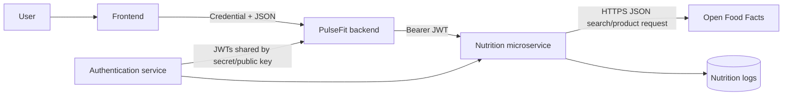

# Activity 3 Case Study — PulseFit Nutrition Microservice

## Purpose and problem

PulseFit users need reliable nutrition information and serving-level macro calculations without duplicating Open Food Facts integration in every client. The current problem is fragmented food lookup, repeated business rules, and the possibility that the client depends directly on an external provider.

## Part A: web services

A **web service** is a software-to-software exchange using standardized protocols; a **REST API** is a contract with resource URLs and HTTP semantics. SOAP commonly uses XML and WSDL, while REST and GraphQL commonly exchange JSON (REST can exchange other formats). An OpenAPI contract makes request, response, status-code, and authentication expectations reproducible across teams.

A monolith reduces deployment boundaries but makes independent scaling and failure isolation harder. A small nutrition microservice next to the PulseFit application is appropriate where one module has different scaling, provider integration, and authentication concerns. Its extra cost includes deployment, monitoring, secret distribution, and network failure handling.

## Part B: service analysis

- **Actors:** PulseFit user, frontend/backend application, nutrition service, Open Food Facts, and future nutrition database.
- **Systems involved:** identity service, nutrition service, public food provider, and PulseFit data service.
- **Failure:** provider timeouts return a structured empty fallback; validation fails locally; authentication failures do not reach nutrition logic.
- **Security:** HTTPS in production, JWT Bearer authentication on writes, environment secrets, provider timeout, and input validation. Relevant OWASP risks include broken access control, injection, and security misconfiguration.
- **Trade-offs:** network latency and operational components increase, but clients are insulated and nutrition behavior is centralized.

## First three endpoints

| Method | Endpoint | Input | Success | Errors |
|---|---|---|---|---|
| GET | `/api/v1/nutrition/search?query=banana&page=1&pageSize=20` | Query and optional pagination | 200 `products[]` and fallback flag | 400 invalid query |
| GET | `/api/v1/nutrition/macro-breakdown/:foodId?quantityGrams=150` | Barcode and quantity in grams | 200 calculated macro values | 400 invalid quantity, 404 unknown/unavailable food |
| POST | `/api/v1/nutrition/logs` | `{ foodId, quantityGrams, mealType, consumedAt? }` | 201 created log | 400 invalid data, 401 missing/invalid token |
