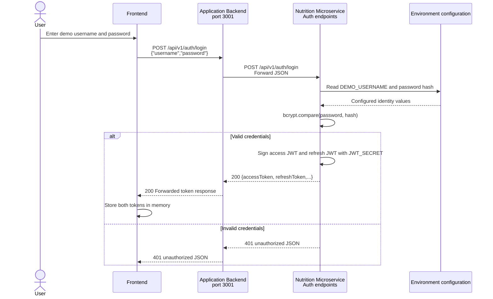
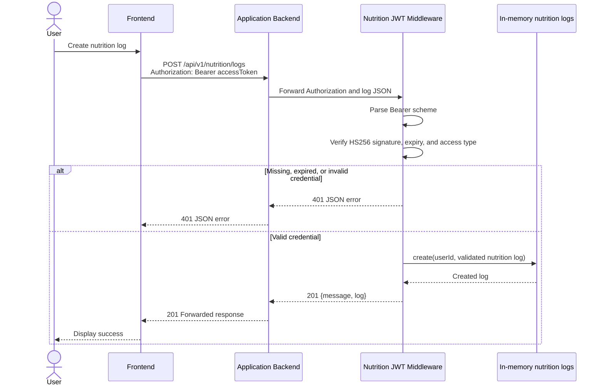
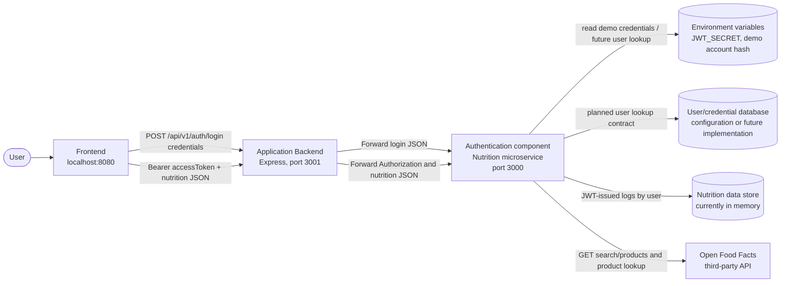

# PulseFit Authentication Report

Repository evidence: this report describes the implementation currently in the PulseFit repository. It is based on the source code, automated tests, and REST request collection rather than on a simulated external identity provider.

## 1. Authentication mechanism

### Choice

PulseFit uses its own **JWT authentication microservice behavior inside the nutrition microservice**:

- `POST /api/v1/auth/login` verifies the demo username and a bcrypt password hash.
- The microservice issues HS256 JSON Web Tokens.
- Protected routes verify the access token with the `Authorization: Bearer <token>` header.
- `POST /api/v1/auth/refresh` exchanges a valid refresh token for a new access token.

JWTs fit the small Node.js/Express microservice architecture because the frontend and nutrition microservice can operate without server-side login sessions. The application backend forwards credentials and access tokens, so there is no separate authentication implementation in the proxy.

This project did **not** use third-party OAuth/OIDC. That is a reasonable choice for the classroom demo, where a local demo account proves authentication and component integration without an external provider, redirect URL, and hosted account configuration.

### Own service versus third-party provider

| Approach | Advantages | Disadvantages |
|---|---|---|
| PulseFit own JWT service | Simple to run locally, controllable credentials and claims, and clear connection to the nutrition microservice | Shared symmetric secret, no real account database, no centralized session revocation, and responsibility for password and key security |
| Third-party OAuth/OIDC provider | Managed password recovery and MFA, mature security controls, federated identity, and shorter custom security surface | Requires provider configuration, network dependency, redirect/CORS setup, and provider-specific contract and privacy handling |

The selected mechanism is appropriate for demonstrating authentication boundaries. It would not be production-ready without a real identity provider or a well-developed user database and a documented key-management strategy.

### Why not sessions

Server-side sessions would require session storage and identity propagation between requests and services. JWT verification is simpler for this stateless exercise, although JWTs require careful expiry and revocation controls.

## 2. Flow

### Login sequence



### Protected request sequence



The credential is verified in the nutrition microservice. The application backend does not duplicate JWT verification; it forwards the `Authorization` header unchanged.

## 3. Tokens, claims, renewal, and logout

### Claims and serialization

Tokens are signed but not encrypted. Therefore, their payload must not contain passwords or sensitive personal information. PulseFit JWTs contain:

| Claim | Purpose |
|---|---|
| `sub` | Authenticated username/subject used as the user identifier in a created log |
| `type` | Distinguishes `access` from `refresh`; access is required for protected routes |
| `iat` | Issued-at time added by the JWT library |
| `exp` | Expiration time |

JWT verification is pinned to HS256 in authentication and refresh middleware. The payload should not be considered confidential merely because it is signed.

### Expiry and renewal

- Access token default: 15 minutes.
- Refresh token default: 7 days.
- Renewal request: `POST /api/v1/auth/refresh` with `{"refreshToken":"..."}`.
- A valid refresh token receives a new access token.
- If renewal fails, the frontend should prompt the user to log in again.

### Logout and revocation

The frontend currently clears the JavaScript variables holding the access and refresh tokens, so logout ends the browser session in the UI. There is no server-side refresh-token storage, denylist, token family identifier, or logout endpoint.

For production, implement:

1. Secure, HttpOnly, SameSite refresh-token cookies.
2. A server-side refresh-token identifier store or hashed token list.
3. Logout deletes or revokes the stored token.
4. Access-token expiry remains short.
5. A process for rotating refresh and signing keys.

The current classroom implementation is unable to revoke an issued access token before it expires.

### Frontend token handling

[The frontend](/C:/Users/The_D/OneDrive/Desktop/PulsefitMicro/apps/frontend/index.html) obtains tokens from login and sends the access token in the Bearer header. It currently stores both tokens in JavaScript variables in memory. This avoids `localStorage`, which remains available to scripts and is vulnerable when XSS exists, but memory does not survive a reload and the refresh token is not protected by cookie attributes. Production should keep the access token in memory and place the refresh token in a Secure, HttpOnly, SameSite cookie.

## 4. Architecture



The diagram distinguishes current components from planned persistence. PulseFit currently has no relational or document database connected to authentication. Demo credentials are read from environment variables; nutrition logs are stored in memory and disappear when the nutrition microservice restarts. Both should be explicitly represented as limitations rather than presented as implemented persistent databases.

### Component contracts

| Pair | Contract |
|---|---|
| Frontend -> backend | `POST /api/v1/auth/login`, `POST /api/v1/auth/refresh`; `GET /api/v1/nutrition/search`, `GET /api/v1/nutrition/macro-breakdown/:foodId`, and `POST /api/v1/nutrition/logs`. JSON and Bearer tokens use `Authorization: Bearer <accessToken>`. |
| Backend -> authentication microservice | Login and refresh JSON are forwarded; upstream 4xx responses are preserved. Protected request JSON and the Authorization header are forwarded by `apps/backend/src/services/nutrition-api.client.js`. |
| Authentication -> configuration/database | Current implementation reads username and bcrypt hash from environment variables. Production should read a user record with identifier and password hash by username/identity identifier. |
| Microservice -> third-party API | Open Food Facts search and product endpoints. The service sends query and food ID parameters and maps the provider response to a product and nutrient shape. |
| Microservice -> log store | Creates and returns an in-memory log containing ID, user ID, food ID, quantity, meal type, consumed date, and creation date. |

## 5. Failure behavior

| Component failure | Expected PulseFit behavior |
|---|---|
| Authentication microservice unavailable | Backend connection failure is converted to generic `502 Nutrition service unavailable`; details are not exposed. The frontend should show an unavailable-service error and offer retry. |
| Login credentials/configuration missing | Login returns a generic `500` if the JWT secret is not configured. Invalid credentials are `401`. Configuration errors are not leaked to the client. |
| Database unavailable | There is no connected database yet. With a real database, login and log operations should fail safely with `503`, use timeout and retry policy where safe, and never expose database errors. |
| Open Food Facts unavailable | Nutrition searches return a successful fallback shape with an empty product list and `fallback: true` where supported. Macro lookup returns a safe `404` or unavailable representation; unexpected upstream failures are sanitized. |
| Backend unavailable | Frontend login and nutrition operations fail at network level; the UI should show a generic connection message and retry rather than expose stack traces. |
| JWT secret unavailable or mismatched | Authentication cannot start or token verification fails. The service must not silently use a weak default secret in production. |

## 6. Security measures and OWASP Top 10:2025

The following matrix maps current controls and remaining risks to OWASP Top 10:2025 categories.

| OWASP 2025 category | Applied measure in PulseFit | Remaining risk / next control |
|---|---|---|
| A01 Broken Access Control | Protected logs require an access JWT and token type is checked. The subject is attached to created logs. | There are no real persisted users and no authorization policy for viewing/updating/deleting other users' logs. Add object-level checks and user ownership. |
| A02 Security Misconfiguration | `.env` is ignored, `.env.example` has placeholders, CORS is configurable, Express hides `x-powered-by`, and JSON response bodies are generic. | Run behind HTTPS, restrict production origins, and remove development/demo credentials for production. |
| A03 Software Supply Chain Failures | Root workspace lockfile records dependency versions and npm reports dependency state. | Run dependency audit/SBOM review and pin reviewed versions in deployment and CI. |
| A04 Cryptographic Failures | Passwords use bcrypt comparison; tokens expire; JWT verification pins HS256; secrets come from environment variables. | Use sufficient random production entropy, rotate and distribute the signing secret securely, and prevent untrusted plaintext logs. Do not place personal data in JWT payloads. |
| A05 Injection | Express JSON parsing and request validation are applied before creating logs. Third-party parameters are passed by the service client. | Add centralized schema validation, escaping/log protection, and parameterized database queries before database integration. |
| A06 Insecure Design | Refresh/access separation, short access expiry, provider timeout handling, and generic upstream errors are included. | Define complete revocation, rate limiting, account lockout, abuse control, recovery, and deletion flows. |
| A07 Authentication Failures | Login compares bcrypt hashes, refresh tokens must be refresh type, auth routes are rate-limited, and missing or modified tokens return 401. | Add account lockout/backoff, MFA, secure account recovery, refresh-token rotation, revocation, and production monitoring. |
| A08 Software or Data Integrity Failures | JWT algorithm verification is pinned and dependencies are locked. | Verify build/release provenance and dependency signatures; protect CI/CD credentials and deployment packages. |
| A09 Security Logging and Alerting Failures | Authentication and upstream errors can be observed in service logs. | Add event IDs, audit login failures, rotation events, log abuse, correlation IDs, redaction, retention policy, and alerts. |
| A10 Mishandling of Exceptional Conditions | Centralized error handlers avoid stack traces and sanitized 502 responses are returned to clients. | Add timeouts, bounded retries, circuit breaker behavior, health checks, and full tests for all upstream failure states. |

OWASP categories and naming can change between release candidates and final publication. The table uses the 2025 category names identified for this unit and should be checked against the OWASP Top 10:2025 release used by the course before final submission.

Additional HTTPS handling:

- Localhost HTTP is only suitable for classroom testing.
- Production deployments must use HTTPS/TLS and secure token cookies.
- `JWT_SECRET` must be a random secret of sufficient length and must not be committed.

## 7. Evidence from the repository

The repository contains executable evidence rather than fabricated screenshots:

- [Nutrition authentication tests](/C:/Users/The_D/OneDrive/Desktop/PulsefitMicro/apps/nutrition-api/test/nutrition.test.js) prove login, refresh, authenticated log creation, missing and tampered JWT rejection, validation, and malformed JSON handling.
- [Backend integration tests](/C:/Users/The_D/OneDrive/Desktop/PulsefitMicro/apps/backend/test/integration.test.js) prove authentication and nutrition requests pass through the application backend and nutrition microservice together.
- [Nutrition REST collection](/C:/Users/The_D/OneDrive/Desktop/PulsefitMicro/apps/nutrition-api/api.http) contains login, missing-token, valid-token, refresh, invalid-input, and protected-request examples.
- [Backend REST collection](/C:/Users/The_D/OneDrive/Desktop/PulsefitMicro/apps/backend/api.http) contains frontend-facing routes through port 3001.
- [JWT implementation guide](/C:/Users/The_D/OneDrive/Desktop/PulsefitMicro/apps/nutrition-api/docs/jwt-guide.md) explains setup and manual verification.

A verified test run should end with no failures:

```text
api:test
  tests 8
  pass 8
  fail 0

backend:test
  tests 9
  pass 9
  fail 0
```

Run:

```sh
npm install
npm test
```

This command runs the microservice and backend suites. The integration suite uses local simulated Open Food Facts and nutrition services, so it tests the project flow without depending on internet availability.

### Manual repository-link demonstration

1. Configure the two `.env` files from `.env.example` and start the nutrition microservice with `npm run api:start`.
2. Start the application backend with `npm run backend:start`.
3. Serve the frontend at port 8080 and open it in the browser.
4. Log in with the demo account configured in `apps/nutrition-api/.env`.
5. Confirm that a valid login creates both tokens.
6. Create a nutrition log through the frontend and confirm HTTP 201.
7. Repeat the log request without the token and confirm HTTP 401.
8. Modify a character in the access token and confirm HTTP 401.
9. Use the refresh endpoint and confirm HTTP 200.

For PDF submission, retain actual terminal screenshots or browser/network screenshots showing the login, successful protected request, rejected request, and refresh response. Do not place real tokens or passwords in the screenshots.
